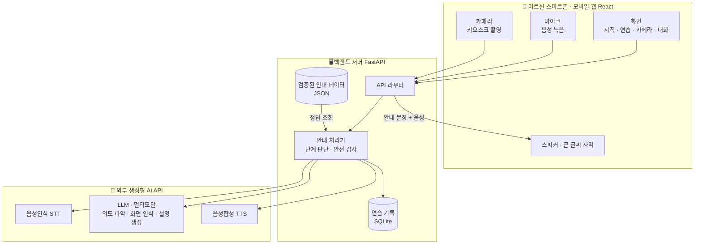
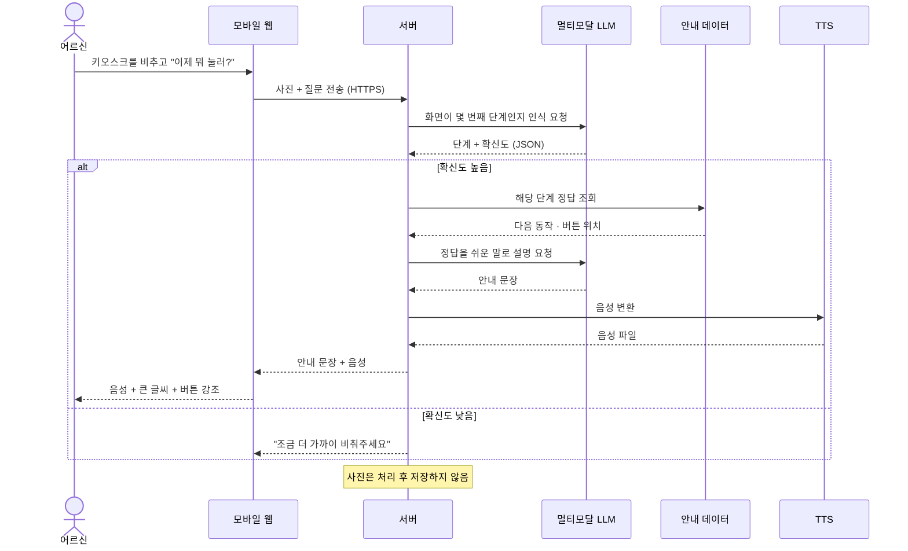
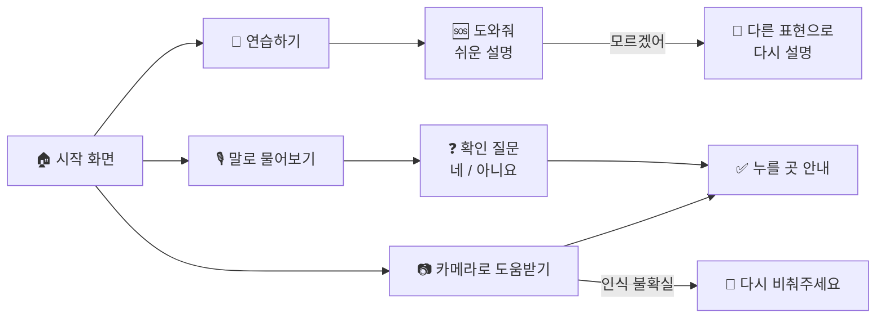

# 🚆 차근차근 — 어르신을 위한 AI 기차표 예매 도우미

> **"이제 누구도 서서 가지 않도록"**
>
> 앱 예매가 어려운 어르신이 **말로 묻거나 카메라로 키오스크 화면을 비추면**,
> 생성형 AI가 다음에 누를 곳을 **음성과 큰 글씨로 차근차근** 알려주는 기차표 예매 도우미입니다.


> 🚧 현재 **개발 진행 중**인 프로젝트입니다. 기능과 구조는 개발 과정에서 바뀔 수 있습니다.

---

## 📑 목차

1. [프로젝트 소개](#-프로젝트-소개)
2. [해결하려는 문제](#-해결하려는-문제)
3. [예상 사용자와 활용 상황](#-예상-사용자와-활용-상황)
4. [주요 기능](#-주요-기능)
5. [시스템 구조](#-시스템-구조)
6. [AI 활용 방안](#-ai-활용-방안)
7. [UI/UX 설계](#-uiux-설계)
8. [기술 스택](#-기술-스택)
9. [프로젝트 구조](#-프로젝트-구조-계획)
10. [실행 방법](#-실행-방법-개발-예정)
11. [개발 일정](#-개발-일정)
12. [안전·개인정보 원칙](#-안전개인정보-원칙)

---

## 💡 프로젝트 소개

| 항목 | 내용 |
|---|---|
| 프로젝트명 | **차근차근** |
| 한 줄 소개 | 눈치 보지 않고 몇 번이든 물어볼 수 있는 AI가, 예매하는 바로 그 순간에 한 단계씩 안내 |
| 핵심 키워드 | 생성형 AI · 멀티모달(화면 인식) · 음성 대화 · 디지털 포용 |
| 과목 | 동양미래대학교 컴퓨터소프트웨어공학과 · 인공지능프로젝트 (개별 프로젝트) |

### 제안 동기

명절 기차에서 다리가 불편하신 어르신들이 몇 시간씩 서서 가시는 모습을 보았습니다.
스마트폰을 잘 쓰는 사람들이 온라인으로 먼저 표를 사고 나면, 역 창구를 찾으신 어르신들께는 입석밖에 남지 않습니다.
바쁜 자녀에게 매번 부탁하기는 눈치가 보이실 것입니다.

**차근차근**은 누구에게도 눈치 보지 않고, 필요한 순간에 몇 번이든 물어볼 수 있는 AI로
어르신들이 **스스로** 좌석을 예매하실 수 있도록 돕고자 합니다.

> AI가 대신 예매하는 것이 아니라, **어르신이 스스로 해낼 수 있게 돕는 것**이 목표입니다.

---

## 😣 해결하려는 문제

| 문제 | 차근차근의 해결 방법 |
|---|---|
| 온라인 예매를 못 해 창구에 가면 이미 매진, 결국 입석 | 예매 앱과 역 키오스크 사용을 그 자리에서 안내 |
| 자녀에게 매번 묻기는 눈치가 보이고, 도와줄 가족이 없기도 함 | 몇 번을 물어도 괜찮은 AI 안내자 |
| 디지털 교육은 교육장에 가야 해서, 정작 예매하는 순간엔 물어볼 곳이 없음 | 예매하는 **바로 그 순간**에 도움 |
| 타자 입력과 화면 캡처가 어려움 | **말하기**와 **카메라로 비추기**만으로 사용 |

---

## 👥 예상 사용자와 활용 상황

**주 사용자** : 스마트폰으로 전화·카카오톡은 쓰지만, 예매 앱은 어려운 60대 이상 어르신
**보조 사용자** : 부모님 예매를 매번 도와드리기 어려운 자녀·보호자

| 상황 | 사용 방법 |
|---|---|
| 🎫 예매 전 연습 | 결제가 되지 않는 모의 예매 화면에서 부담 없이 반복 연습 |
| 🏢 역 키오스크 앞에서 막혔을 때 | 카메라로 키오스크 화면을 비추면 AI가 다음에 누를 곳을 안내 |
| 📱 휴대폰 예매 앱에서 막혔을 때 | AI가 "화면 맨 위에 뭐라고 쓰여 있어요?"처럼 물으며 대화로 현재 단계를 찾아 안내 |
| ❓ 궁금한 게 생겼을 때 | "이거 누르면 돈 나가?" 같은 질문에 쉬운 말로 답변 |

---

## ⚙️ 주요 기능

| 번호 | 기능 | AI 역할 | 우선순위 |
|:---:|---|---|:---:|
| ① | **말로 묻고 답하기** | 어르신의 말에서 의도(목적지·날짜·질문)를 파악하고 중요한 정보는 다시 확인 | ⭐ 1순위 |
| ② | **카메라로 비추면 화면 읽어주기** | 멀티모달 AI가 키오스크 화면을 인식해 현재 단계와 다음 동작을 파악 | ⭐ 1순위 |
| ③ | **쉬운 말 안내 + 다시 설명하기** | 검증된 안내를 어르신 눈높이로 설명하고, 이해 못 하시면 매번 다른 표현으로 재설명 | ⭐ 1순위 |
| ④ | **대화로 현재 위치 찾기** | 휴대폰 앱 화면을 말로 설명하시면 현재 단계를 추론해 안내 | 2순위 |
| ➕ | 맞춤 연습 문제 · 실시간 음성 대화 | 자주 막힌 단계를 반영한 연습 과제 생성 | 부가 |

> 💡 휴대폰 예매 앱은 같은 휴대폰 카메라로 비출 수 없기 때문에 **앱은 대화(④)로, 키오스크는 카메라(②)로** 안내합니다.

### 기능 예시 (입력 → 처리 → 출력)

**② 카메라로 비추면 화면 읽어주기**

| 📥 입력 | ⚙️ 처리 | 📤 출력 |
|---|---|---|
| 카메라로 비춘 키오스크 화면 + "이제 뭐 눌러?" | ① 멀티모달 AI가 화면 단계 인식 → ② 검증된 안내 데이터와 대조 → ③ 불확실하면 다시 비춰달라고 요청 → ④ 사진은 저장하지 않음 | "오른쪽 위 '승차권 구매' 버튼을 눌러주세요" (음성 + 큰 글씨) |

**③ 쉬운 말 안내 + 다시 설명하기**

| 📥 입력 | ⚙️ 처리 | 📤 출력 |
|---|---|---|
| 현재 단계 + "무슨 말인지 모르겠어" | 안내 데이터 조회 → LLM이 이전 설명과 다른 표현·비유로 재생성 | "은행 번호표 뽑는 것처럼, 먼저 가고 싶은 곳을 고르는 거예요" |

---

## 🏛️ 시스템 구조

브라우저는 AI API를 직접 호출하지 않고, **모든 요청은 서버를 거칩니다.** (API 키 보호 · 정답 데이터 대조)



### 처리 흐름 예시 — 카메라로 비추기



### API 설계 (초안)

| 메서드 | 경로 | 설명 | 관련 기능 |
|---|---|---|:---:|
| `POST` | `/api/voice` | 음성 질문 → 텍스트 변환 → 의도 파악 → 확인 질문 또는 안내 | ① ④ |
| `POST` | `/api/camera` | 키오스크 사진 → 단계 인식 → 정답 대조 → 안내 | ② |
| `POST` | `/api/explain` | 현재 단계 쉬운 설명 · 다시 설명 (연습 모드) | ③ |
| `POST` | `/api/tts` | 안내 문장을 음성으로 변환 | 전체 |
| `GET` | `/api/guide/{flow}/{step}` | 검증된 안내 데이터 조회 | ② ③ ④ |
| `POST` | `/api/practice/log` | 익명 연습 기록 저장 (막힌 단계, 다시 설명 요청 횟수) | 부가 |

### 검증된 안내 데이터 구조 (예시)

예매 단계마다 정답을 미리 작성해 두고, **AI는 이 데이터에 있는 동작만 안내**합니다.

```json
{
  "flow": "kiosk_ticket",
  "step_id": "kiosk_03",
  "screen_name": "도착역 선택",
  "visible_keywords": ["도착역", "역 선택"],
  "next_action": "가고 싶은 도착역 버튼을 누른다",
  "button_hint": "화면 가운데 역 이름 버튼들",
  "is_payment_step": false,
  "easy_words": "가고 싶은 곳 이름을 눌러주세요"
}
```

---

## 🤖 AI 활용 방안

> **핵심 전략** — "무엇을 누를지"는 **검증된 데이터**가, "어떻게 말할지"는 **생성형 AI**가 맡습니다.
> 생성형 AI의 유연한 설명 능력은 살리고, 잘못된 안내(환각)는 데이터로 통제합니다.

| 기술 | 역할 | 사용 기능 | 선정 기준 |
|---|---|:---:|---|
| 🎙️ 음성인식 (STT) | 어르신의 말을 글자로 변환 | ① ③ ④ | 한국어·어르신 발음 인식 정확도 |
| 🧠 LLM | 의도 파악, 쉬운 설명·재설명, 현재 단계 추론 | 전체 | 한국어 표현력, JSON 형식 출력 지원 |
| 📷 멀티모달 AI | 카메라로 비춘 키오스크 화면 인식 | ② | 화면 속 한글 문구 인식 정확도 |
| 📚 RAG | 검증된 안내 데이터를 프롬프트에 넣어 정답 고정 | ② ③ ④ | AI가 지어낸 안내 방지 |
| 🔊 음성합성 (TTS) | 안내를 자연스러운 음성으로 읽어주기 | 전체 | 또렷한 발음, 속도 조절 |

> 사용할 AI API는 한국어 성능과 비용을 비교해 확정하며, 확정 후 이 문서에 반영합니다.

### 프롬프트 설계 (안내 문장 생성용 초안)

```text
당신은 어르신의 기차표 예매를 돕는 안내자 '차근차근'입니다.

[규칙]
1. 반드시 [정답 데이터]에 있는 동작만 안내합니다. 데이터에 없는 버튼이나 순서는 절대 지어내지 않습니다.
2. 한 번에 한 가지 동작만, 두 문장 이내로 말합니다.
3. 어려운 말(인증, 조회 등)은 쉽게 바꾸고 존댓말을 씁니다.
4. 다시 설명을 요청받으면 [이전 설명]과 다른 표현이나 비유를 씁니다.
5. 결제 단계는 "돈이 나가는 단계예요"라고 먼저 알리고 확인을 받습니다.
6. 확실하지 않으면 추측하지 말고 다시 물어봅니다.

[정답 데이터] {guide_step_json}
[이전 설명] {previous_answer}
[어르신 말씀] {user_text}
```

### 오류·환각 방지 장치

| 위험 | 대응 방법 |
|---|---|
| AI가 없는 버튼이나 순서를 지어냄 | 정답 데이터 밖의 안내 금지 + 서버에서 안내 문장의 버튼 이름이 데이터와 일치하는지 검사 |
| 화면을 잘못 인식 | 단계·확신도를 JSON으로 받고, 기준 미만이면 다시 비춰달라고 요청 (기준값은 테스트로 조정) |
| 결제 단계 오안내 | 안내 데이터의 결제 단계 표시를 보고 반드시 이중 확인 |
| 말을 잘못 알아들음 | 목적지·날짜 같은 중요 정보는 "맞으세요?" 확인 질문 |
| 개인정보 노출 | 사진·음성 미저장, 로그에 원문 기록 안 함 |

### AI 성능 평가 계획

| 평가 항목 | 측정 방법 | 목표 (초안) |
|---|---|---|
| 화면 인식 정확도 | 키오스크·모의 화면 사진 30장으로 단계를 맞히는 비율 | 80% 이상 |
| 응답 시간 | 질문 후 음성 안내가 시작될 때까지 걸리는 시간 | 5초 이내 |
| 설명 이해도 | 어르신 테스트 후 "이해하기 쉬웠다" 5점 척도 | 평균 4점 이상 |
| 과제 완료율 | 다른 사람 도움 없이 모의 예매를 끝까지 마친 비율 | 중간 → 최종 테스트에서 향상 |

---

## 🎨 UI/UX 설계

### 화면 흐름



### 화면 구성

| 화면 | 구성 요소 | 어르신 배려 포인트 |
|---|---|---|
| 🏠 시작 화면 | 큰 버튼 3개: 연습하기 / 카메라로 도움받기 / 말로 물어보기 | 한 화면에 버튼 3개만, 처음 켜면 음성 안내 |
| 🎫 모의 예매 연습 | 진행 표시(예: 2/6단계), 역 버튼, 도와줘 버튼 | 결제 없음, 눌러야 할 버튼이 반짝이며 강조 |
| 📷 카메라 도움 | 카메라 미리보기, 인식된 버튼 초록 테두리, 자막 | "조금 더 가까이 비춰주세요" 같은 음성 안내 |
| 🎙️ 대화 화면 | 큰 글씨 말풍선, 네/아니요 버튼, 큰 마이크 버튼 | 무전기 방식이라 말할 때가 명확함 |

### UX 설계 원칙

| 항목 | 설계 기준 | 이유 |
|---|---|---|
| 🔤 글자 크기 | 본문 20px 이상, 안내 자막 28px 이상 | 노안으로 작은 글씨를 읽기 어려운 분 배려 |
| 👆 버튼 크기 | 최소 60px 이상 (일반 모바일 권장 크기 44pt·48dp보다 크게) | 손 떨림으로 인한 잘못 누름 방지 |
| 🎨 색 대비 | 글자와 배경 명암비 4.5:1 이상 (WCAG AA) | 시력이 약해도 잘 보이도록 |
| 1️⃣ 한 화면 한 동작 | 한 화면에 핵심 버튼 3개 이하 | 선택지가 많으면 망설이게 됨 |
| 🔊 이중 안내 | 음성 + 큰 글씨 자막 + 버튼 강조를 항상 함께 | 못 들었거나 못 봤을 때 대비 |
| 🔙 되돌리기 | 모든 화면에 다시 듣기 · 처음으로 버튼 | 길을 잃어도 언제든 돌아갈 수 있도록 |
| 🤗 말투 | "괜찮아요, 다시 해볼게요"처럼 탓하지 않는 안내 | 자신감을 잃지 않고 끝까지 해내도록 |

---

## 🛠️ 기술 스택

| 구분 | 기술 | 선택 이유 |
|---|---|---|
| Frontend | React (모바일 웹) | 앱 설치 없이 링크로 사용, 브라우저에서 카메라·마이크 사용 가능 |
| Backend | FastAPI (Python) | AI API 호출 순서 제어와 안내 데이터 관리가 편리 |
| AI | LLM API (이미지 입력 지원) · STT API · TTS API | 한국어 성능과 비용을 비교해 확정 예정 |
| Data | JSON · SQLite | 단계별 안내 데이터와 익명 연습 기록 저장 |

---

## 📁 프로젝트 구조 (계획)

```text
chageunchageun/
├── frontend/                # React 모바일 웹
│   └── src/
│       ├── pages/           # 시작 · 연습 · 카메라 · 대화 화면
│       └── components/      # 큰 버튼, 자막, 마이크 버튼 등
├── backend/                 # FastAPI 서버
│   ├── app/
│   │   ├── main.py
│   │   ├── routers/         # voice, camera, explain, guide, practice
│   │   └── services/        # stt, llm, vision, tts, 안전 검사
│   └── data/
│       └── guides/          # 검증된 예매 단계 안내 데이터 (JSON)
├── docs/                    # 기획 문서, 테스트 결과
├── .env.example             # 환경 변수 예시 (실제 키는 올리지 않음)
└── README.md
```

---

## ▶️ 실행 방법 (개발 예정)

> 아직 개발 중이며, 구현이 진행되면 실제 실행 방법으로 업데이트합니다.

```bash
# 1. 저장소 받기
git clone https://github.com/seong-eun125/chageunchageun.git
cd chageunchageun

# 2. 백엔드 실행 (예정)
cd backend
pip install -r requirements.txt
cp ../.env.example .env      # .env에 API 키 입력
uvicorn app.main:app --reload

# 3. 프론트엔드 실행 (예정)
cd ../frontend
npm install
npm run dev
```

> ⚠️ 브라우저의 카메라·마이크 기능은 **HTTPS 또는 localhost**에서만 동작합니다.

---

## 📅 개발 일정

| 주차 | 기간 | 단계 | 목표 |
|:---:|---|:---:|---|
| 1주차 | 9/29 – 10/5 | 기획 | 주제 선정, 기획서 작성, 예매 단계 조사 |
| 2주차 | 10/6 – 10/13 | 기획 | AI API 비교·선정, 시스템·화면 설계 → **10/13 기획 완료** |
| 3주차 | 10/14 – 10/19 | 구현 | 모의 예매 화면 + 검증된 안내 데이터 + 기능 ③ |
| 4주차 | 10/20 – 10/26 | 구현 | 음성 입출력 (기능 ①) |
| 5주차 | 10/27 – 11/2 | 구현 | 카메라 화면 인식 (기능 ②) → **첫 시연 버전** |
| 6주차 | 11/3 – 11/9 | 테스트 | 11/8 어르신 중간 테스트, 다시 설명 고도화 |
| 7주차 | 11/10 – 11/16 | 개선·발표 준비 | 피드백 반영 → **11/11 기능 완성**, 11/15 최종 테스트, 발표 리허설 |
| 발표 | 11/17 | 최종 발표 | 수업시간 발표 (5분, 시연 30초 포함) |

---

## 🛡️ 안전·개인정보 원칙

- AI는 예매·결제를 **대신하지 않고 안내만** 합니다. (매크로 제재 문제와 결제 사고 방지)
- 예매 순서와 버튼 위치는 **검증된 데이터**에서 가져와 AI가 지어낸 안내를 막습니다.
- 화면 인식이 불확실하면 **추측하지 않고** 다시 비춰달라고 요청하며, 결제 관련 화면은 반드시 한 번 더 확인합니다.
- 카메라 사진과 음성은 **처리 후 저장하지 않으며**, 연습 기록은 **익명**으로만 저장합니다.
- API 키는 서버 환경 변수(`.env`)에만 보관하고 **저장소에 올리지 않습니다.**
- 사용자 테스트는 어르신의 **동의**를 받고, 실제 결제 없이 **모의 화면으로만** 진행합니다.

### 범위와 한계

스마트기기를 전혀 쓰지 않는 어르신은 이번 범위에서 제외하며, 전화 음성 AI·복지관 비치형 태블릿은 향후 과제로 둡니다.

---

## 👤 개발자

| 이름 | 소속 | GitHub |
|---|---|---|
| 임성은 | 동양미래대학교 컴퓨터소프트웨어공학과 | [@seong-eun125](https://github.com/seong-eun125) |
